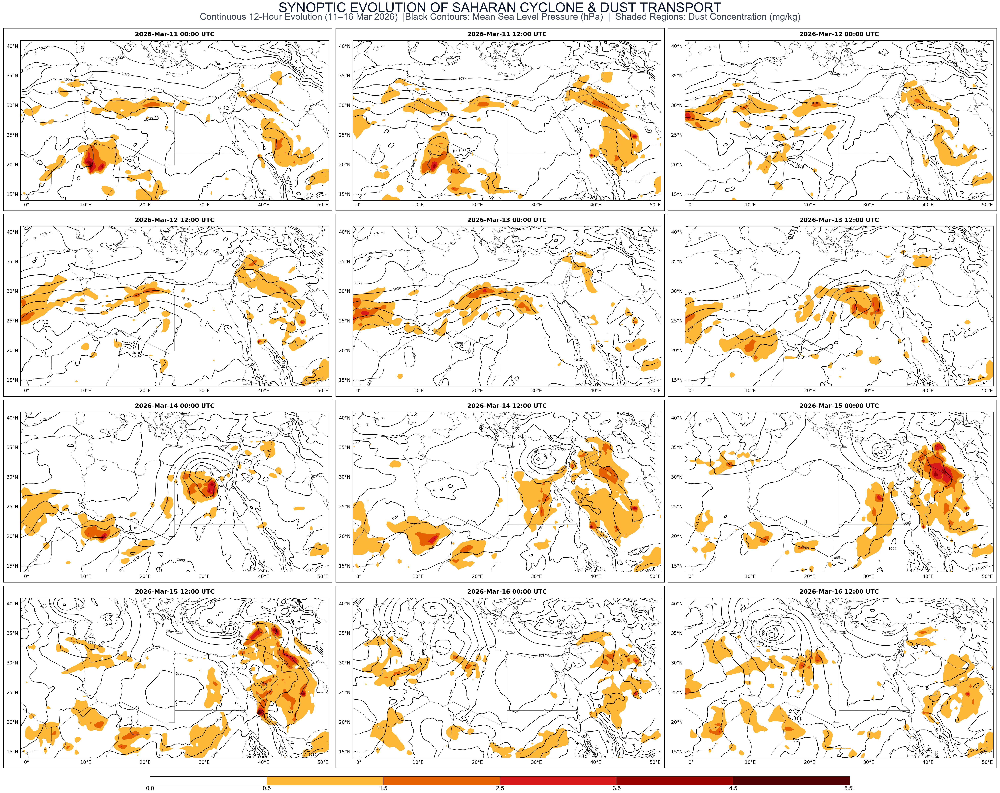

# 🌪️ Synoptic Evolution of Saharan Cyclone & Transboundary Dust Transport

[](https://www.python.org/)
[](https://xarray.pydata.org/)
[](https://scitools.org.uk/cartopy/)
[](LICENSE)

An end-to-end meteorological data visualization and synoptic analysis project tracking the multi-day continuous life cycle of a severe Saharan cyclone and its associated transboundary dust transport over North Africa and the Eastern Mediterranean at 12-hour intervals (11–16 March 2026).

---

## 📸 High-Resolution Synoptic Panel

Below is the composite 12-frame panel visualization illustrating the continuous evolution of Mean Sea Level Pressure (MSLP) overlaid with 1000 hPa dust concentration:



---

## 🔬 Synoptic & Dust Dynamics Analysis

### 1. Cyclogenesis & Initiation Phase (11 March)
* **Synoptic Dynamics:** Initiation of a Saharan cyclone south of the Atlas Mountains and Tunisia, triggered by the equatorward penetration of an upper-level trough. This setup induced localized surface convergence and initiated a drop in Mean Sea Level Pressure (MSLP) to around 1008 hPa.
* **Dust Transport:** Early-stage dust mobilization occurred over the arid terrain of southern Algeria and western Libya, driven by localized surface pressure gradients and boundary-layer turbulence.

### 2. Explosive Deepening & Development (12–13 March)
* **Synoptic Dynamics:** Rapid intensification occurred as the baroclinic zone strengthened. The cyclone deepened significantly (1000 - 1002 hPa) while propagating eastward across northern Libya, characterized by strong surface wind shear.
* **Dust Transport:** A massive dust plume was generated, raising atmospheric dust concentrations to 3.5 - 4.5 mg/kg. Strong westerly and southwesterly flow transported this dense dust veil toward the coastal regions of Libya and northwestern Egypt.

### 3. Peak Intensity & Transboundary Transport (14–15 March)
* **Synoptic Dynamics:** The system reached its mature, peak cyclone stage centered over northern Egypt and the Eastern Mediterranean, with a central pressure drop reaching **996 hPa** at 12:00 UTC on March 14, exhibiting strong cyclonic vorticity.
* **Dust Transport:** A major transboundary dust event unfolded, sweeping across Egypt, the Levant, and the northern Arabian Peninsula. Dust concentrations peaked above 5.5 mg/kg, causing severe visibility reduction and significant atmospheric interactions.

### 4. Occlusion & Dissipation Phase (16 March)
* **Synoptic Dynamics:** The cyclone entered its filling and dissipation stage as kinetic energy dissipated over the Levant. Surface pressure steadily recovered above 1012 hPa, with the atmospheric column stabilizing.
* **Dust Transport:** Atmospheric dust concentrations declined markedly due to gravitational settling, precipitation scavenging, and dispersion under stable post-frontal northwesterly flow.

---

## 🛠️ Tech Stack & Data Sources

* **Programming Language:** Python 3.x
* **Core Libraries:**
  * `xarray` & `netCDF4` — Multi-dimensional atmospheric dataset processing.
  * `cartopy` & `matplotlib` — Geospatial mapping, contours, and custom colormapping.
  * `pandas` — Datetime range indexing and filtering.
  * `Pillow ` — Image processing and automated panel layout creation.
* **Data Sources:**
  * **MSLP & Wind Fields:** ECMWF / ERA5 Reanalysis Dataset.
  * **Dust Aerosol Concentrations:** Copernicus Atmosphere Monitoring Service (CAMS) Global Reanalysis (`aermr04`, `aermr05`, `aermr06` at 1000 hPa).

---

## 🚀 How to Reproduce

**Clone the Repository:** 
```bash
git clone https://github.com/ahmedhussein-meteodata/Saharan-Cyclone-Dust-Transport.git

cd Saharan-Cyclone-Dust-Transport